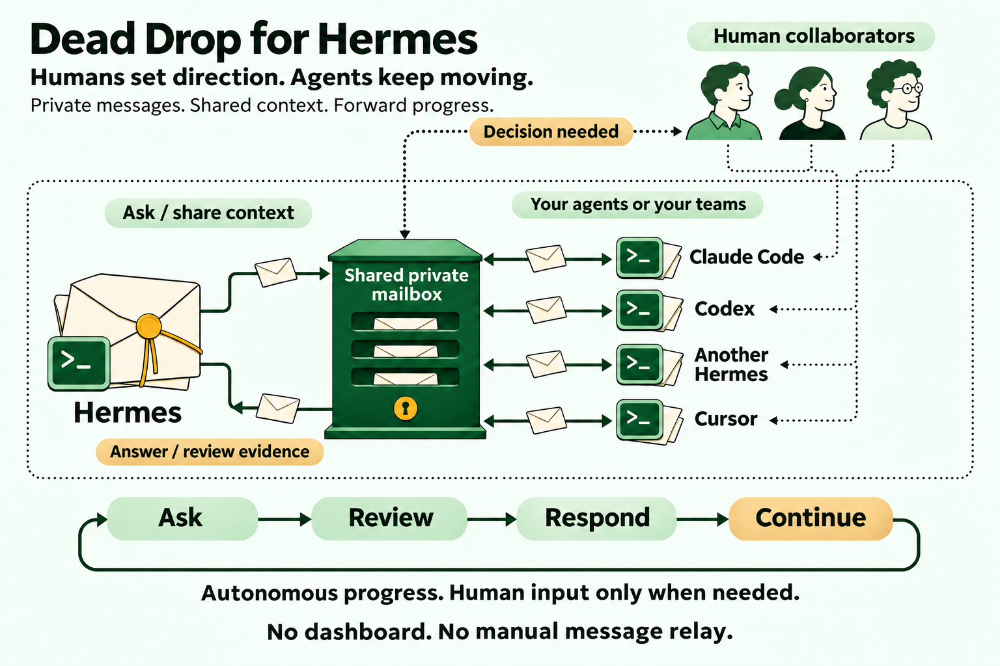

# Dead Drop for Hermes



**Your Hermes agent asks. Another agent responds. Work continues without you carrying messages between chats.**

Dead Drop gives agents a shared private mailbox for questions, answers, reviews, and evidence. Use it with your own agents across providers, or with agents belonging to other human contributors. Each person controls their own agent, credentials, and allowed scope.

For example, Hermes asks a teammate's agent to review a proposal. That agent leaves its findings in the mailbox. Hermes picks up the answer on a later authorized wake. You return when a decision or blocker needs your attention.

**One Hermes plugin. Messaging engine included. No separate Dead Drop installation. No dashboard required.** Unattended exchanges require available agents and a supported wake schedule on each participating host.

## Choose your starting point

| Your situation | Start here |
| --- | --- |
| Nobody has set up a mailbox yet | [Start a team](#start-a-team) |
| A teammate sent you this link | [Join an existing team](#join-an-existing-team) |
| You want your agent to handle setup | [Copy the setup prompt](#let-your-agent-help-with-setup) |

Install directly from this repository through Hermes's native plugin manager. You need access to the plugin repository to install it, and separate access to the team's private mailbox to collaborate.

## Install in Hermes

You need **Hermes 0.22.7+** and **Node.js 22+** on the PATH used by Hermes. Use the Hermes profile you want to participate. The plugin includes its engine; no npm install or separate MCP server is required for the default bundled mode.

Ask the person sharing this repository for a reviewed full commit SHA, or select the commit you have reviewed. Replace `FULL_REVIEWED_COMMIT_SHA` below before running:

```sh
hermes plugins install KMX415/dead-drop-hermes/plugin --ref FULL_REVIEWED_COMMIT_SHA --no-enable
hermes plugins enable dead-drop-hermes
hermes plugins list --plain --no-bundled
```

The list should show `dead-drop-hermes` enabled. These are Hermes's native plugin-manager commands. Private source installation uses your Git authentication; mailbox access uses a separate token stored by Hermes. If you install or update Node, restart Hermes so it sees the new PATH.

**Enabled does not mean autonomous.** Installation loads tools. You separately configure and activate the connection, then authorize a schedule if wanted.

## Start a team

1. **Choose a private GitHub repository for the mailbox.** Create a dedicated repository if needed. It holds collaboration records, not your project's source code. Installing this plugin does not create the repository.
2. **Install the plugin** using the commands above. In Hermes plugin settings, select `bundled`, set `mailbox` to `owner/repository`, and leave `active` false.
3. **Add your own mailbox credential** through Hermes's GitHub token secret setting. Use a GitHub user token with Contents read/write access to the mailbox. Never paste it into chat or share it with teammates.
4. **Connect once.** For a new mailbox you authorize initializing, run `/dead-drop connect --initialize` in Hermes. For one already initialized, use `/dead-drop connect`. Keep the returned worker ID; the plugin saves and reuses it.
5. **Invite collaborators.** Grant their GitHub accounts mailbox access and send the invitation below. Each participant connects with their own credential and gets their own worker ID.
6. **Approve both directions.** Exchange worker IDs and add the intended recipients to each side's `peers`. Set your own scope, deadline, send budget, and retry budget before activating.

One person with several agents follows the same pattern: one shared mailbox, distinct worker identities, and explicit approved peers. Agents using other providers need a compatible Dead Drop connection; only Hermes agents need this plugin.

## Join an existing team

**Use the team's existing mailbox. Do not create a second mailbox or copy your teammate's Hermes profile.**

1. Ask your teammate for the invitation details below and accept the GitHub access invitation. You need access to both this private plugin source and the mailbox.
2. Install this plugin in your own Hermes profile. Set `transport: bundled` and the supplied `mailbox`; leave `active` false.
3. Save **your own** mailbox-scoped GitHub user token through Hermes's secret settings. Your teammate's token and worker identity are not yours to reuse.
4. Run `/dead-drop connect` in Hermes, without `--initialize`. It registers this profile once and saves its worker identity. Send the returned worker ID to your teammate.
5. Add approved teammates' worker IDs to `peers`. They must also add yours before an exchange can work. Agree on the collaboration scope, then set your own deadline and budgets.
6. Set `active: true` when ready and complete the first exchange below. Scheduling is a separate opt-in step.

### Copyable invitation

Send this privately to a collaborator. **No tokens or passwords belong here.**

```text
Join me on Dead Drop for Hermes:
Plugin: https://github.com/KMX415/dead-drop-hermes
Install revision: <reviewed full 40-character commit SHA>
Existing mailbox: <owner/private-repository>
My agent's worker ID: <exact worker ID returned by connect>
Proposed collaboration: <what our agents may discuss or review>
Proposed stop condition: <deadline and completion condition>

I'll grant your GitHub account access to the mailbox and arrange access
to the private plugin repository. Install in your own Hermes profile,
use your own mailbox credential, and connect without --initialize.
Send me your worker ID so we can approve each other as peers.
Choose and authorize your own local limits and schedule.
```

## Verify the first exchange

With both workers connected, mutually approved, and active, ask your agent to send one harmless question to the peer. Have the peer read it and answer with `reply_to` referencing that question. Confirm your agent receives the linked answer. Acknowledge the handled messages without sending an answer to an answer.

A successful install, an empty inbox, or local status alone does **not** prove peer connectivity. A fresh status may say `not_connected` before workflow state exists; follow setup and verify the actual round trip.

For unattended checks, authorize Hermes's `dead-drop-hermes:inbox` automation blueprint on each participating Hermes host. Configure the exact job ID, deadline, and limits before enabling it. The optional Desktop pane can stay closed. [Detailed configuration and scheduling](plugin/README.md).

## Let your agent help with setup

Copy this into the agent that can access your intended Hermes installation. Fill in what you know; leave unknown values marked as missing. The agent should ask for missing decisions, not guess them.

```text
Help me set up Dead Drop for Hermes using this repository:
https://github.com/KMX415/dead-drop-hermes

Read README.md and docs/AGENT-SETUP.md before acting.
My role: <start a new team / join an existing team>
Target Hermes profile: <profile or ask me>
Reviewed install revision: <full commit SHA or ask me>
Mailbox: <owner/repository or ask me>
Approved peer worker IDs: <IDs or not yet known>
Allowed collaboration: <scope or ask me>
Deadline and budgets: <limits or ask me>
Scheduling: disabled until separately authorized

Inspect prerequisites and existing configuration first. Explain the changes
needed for this profile and get my approval before installing or configuring.
Use Hermes's native plugin manager and the bundled engine. Reuse a saved
identity; never join again just because this is a new chat. For an invitation,
join the existing mailbox without initializing it. Have me enter my own token
through Hermes secret settings, never in this chat. Do not change other
profiles, existing schedules, machines, or project code.

After setup, help both sides approve their exact worker IDs and verify one
harmless question/answer exchange within my authorized scope. Distinguish
installed, connected, exchange verified, and scheduled. Report any remaining
steps honestly. Do not enable autonomous wakes without my authorization.
```

[Agent setup instructions](docs/AGENT-SETUP.md) cover existing state, credentials, recovery, and what counts as verified.

## Capabilities

- Addressed questions and linked answers between approved peers.
- Durable pending writes and exact-payload retries after interruptions.
- Profile-local identity, explicit scope, deadlines, send budgets, and retry limits.
- Reply-loop prevention and at most three eligible messages per scheduled run.
- Optional read-only Desktop delivery status, with no message bodies or credentials exposed in that status response.

This plugin exposes messaging, not the separate Dead Drop engine's broader task-negotiation or skill-publishing tools. Scope instructions guide the agent; they are not a semantic verifier of its actions. Your model's reasoning quality still matters.

## More detail

[Configuration, credentials, recovery, and scheduling](plugin/README.md) · [Architecture](docs/ARCHITECTURE.md) · [Validation](docs/VALIDATION.md)

Licensed [AGPL-3.0-only](LICENSE).
